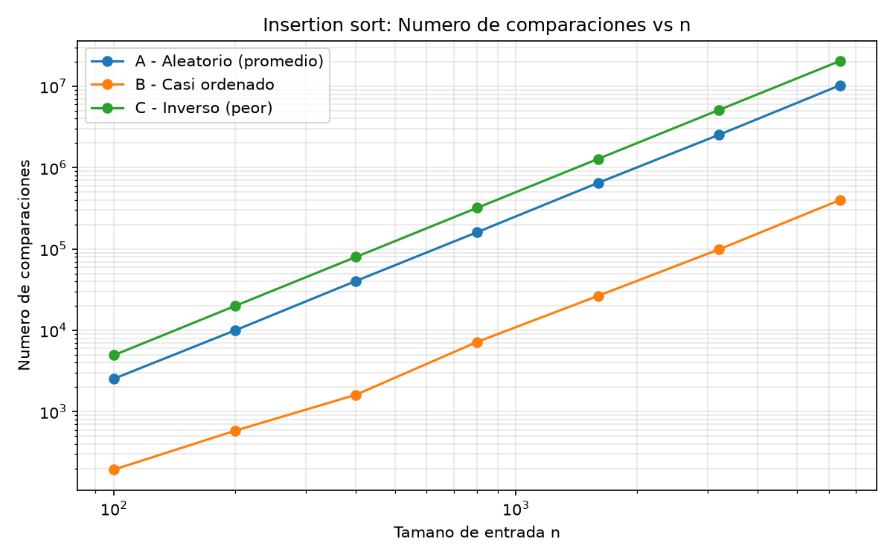
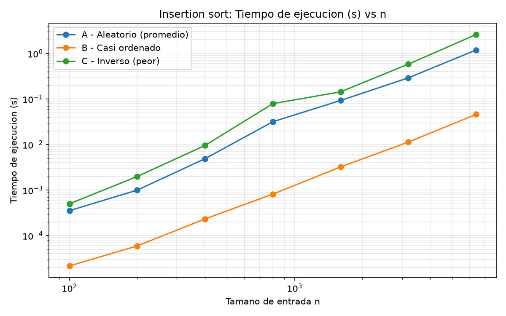
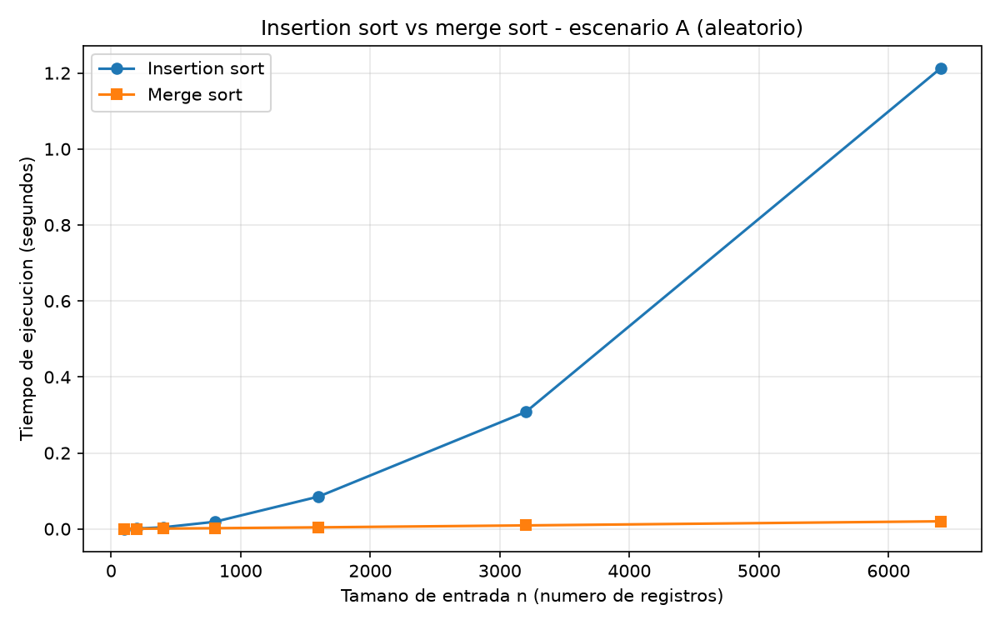

# Laboratorio 1 — Plataforma Tamiza

**Autor:** [Nombre completo]

## Instrucciones para reproducir el experimento

Requiere Python 3.10 o superior (se usa `list[int]` en las firmas) y `matplotlib`.

```bash
# Crear y activar el entorno virtual
python -m venv .venv
.venv\Scripts\activate          # Windows
# source .venv/bin/activate     # Linux / macOS

pip install matplotlib

# Parte 3: casos de insertion sort (genera graficas/parte3_*.png)
python parte3_casos.py

# Parte 4: insertion sort vs merge sort (genera graficas/parte4_tiempo.png)
python parte4_complejidad.py
```

Las gráficas se guardan en la carpeta `graficas/`. Los tiempos varían un poco entre equipos; el número de comparaciones es reproducible porque los generadores usan semilla fija (42).

---

## Introducción

La Secretaría de Salud utiliza la plataforma Tamiza para organizar los resultados de tamizaje cardiovascular de 340 laboratorios e IPS. Actualmente hay **1.200.000 registros pendientes de gestión** y el sistema debe ordenarlos por índice de riesgo, de mayor a menor, entre las 2:00 a. m. y las 6:00 a. m.

El algoritmo que se utiliza es **insertion sort**. Aunque antes funcionaba con una cantidad menor de registros, ahora no siempre termina dentro del tiempo disponible. A continuación, se analiza por qué es necesario revisar el algoritmo y qué responsabilidades ambientales y éticas implica esta decisión.

## Parte 1. Análisis del algoritmo antes de comprar hardware
Considero que se debe analizar primero el algoritmo porque el hecho de que haya funcionado durante ocho años no significa que siendo idóneo para la cantidad de datos que procesar en la actualidad.

Se debe diferenciar entre la corrección y la eficiencia con respecto al tiempo de ejecución. La corrección es la que se encarga del ordenamiento de los registros filtrando por el indice de riesgo, del mas alto al mas bajo. Por otro lado, la eficiencia con respecto al tiempo que consiste en realizar ese trabajo dentro del plazo disponible. Un algoritmo puede entregar una lista correctamente ordenada, pero tardar tanto que el resultado no este listo o disponible cuando se necesite.

La restricción que se incumple es la ventana de cuatro horas. (Entre las 2:00 AM y las 6:00AM) El algoritmo actual, Insertion sort, se conoce por su crecimiento cuadrático donde el peor caso es O(n²), lo que nos indica que al aumentar la cantidad de datos o registros el trabajo o procesamiento que se debe hacer aumenta mucho más que la cantidad de datos a procesar.

Exactamente por esa misma razón, duplicar el la velocidad del servidor no es una solución viable, porque al tener una computadora más rápida podría servir muy superficialmente, si hablamos que duplicamos su velocidad, estamos diciendo que la mejoramos por dos, mientras que los datos crecen de forma cuadrática, es cuestión de tiempo para que vuelva y falle. El problema no es necesariamente la maquina, si no el algoritmo que se usa para el procesamiento de datos. Por eso primero evaluaría un algoritmo como merge sort, cuyo tiempo de ejecución crece como O(n log(n)), y se compara con los tres escenarios, así dar el dictamen correcto si hace falta mejorar el hardware o no.

Un ejemplo diferente sería. Un sistema de gestión de inventario de una bodega o negocio que debe ordenar alrededor de 200,000 registros de salida, para generar una alerta diaria antes de cerrar la bodega entre las 4:00 PM y las 6:00 PM para así tener un reporte diario y poder surtir, p se utiliza insertion sort va requerir una cantidad muy grande de procesamiento, y no alcanzar la ventana de 2 horas. Puede que termine después pero no va alcanzar para surtir.

En conclusión, antes de invertir en una mejor maquina o servidor mas potente, se debe analizar el algoritmo para poder dar el dictamen correcto.

## Parte 2. Responsabilidad ambiental y ética de la implementación

Como responsable técnico de Tamiza, considero que elegir un algoritmo no consiste solamente en conseguir que el programa funcione, si no también en pensar en sus consecuencias ambientales y para las personas que dependen de sus resultados.

### Dimensión ambiental.

El tiempo que tarda el algoritmo en ordenar los 1.200.000 registros, se va consumir mas energía durante el procesamiento nocturno. Mientras el programa se ejecuta, el servidor va estar funcionando a una muy alta capacidad, ademas si le sumamos el tiempo de operación, el consumo de energía se va subir mucho, y por ende el impacto ambiental va a ser mas significativo.

Esto también se debe analizar a largo plazo. Tamiza ejecuta este proceso todas las madrugadas entre las 2:00 Am y 6:00 Am, así que aunque sean 4 horas en un día, el acumulado durante meses o años, va a ser una diferencia muy significativa. Si se mantiene un algoritmo que necesita demasiado tiempo, se podria gastar energía innecesariamente. Además, comprar un servidor del doble de velocidad también va a consumir energía indirectamente y dejar incluso un impacto ambiental más marcado, por todo el proceso de fabricación y mantener otro equipo.

Por eso considero que se debe buscar un algoritmo que ordene los registros en menos tiempo y medir el consumo real antes y después del cambio. Así se puede reducir el uso innecesario  de energía sin afectar el resultado.

### Dimensión ética

La demora o el fallo del algoritmo puede perjudicar directamente a los pacientes.

 **Un paciente con riesgo cardiovascular alto queda de la lista del día.** 
 Si el proceso no termina en el tiempo requerido, este paciente podría no recibir una llamada para solicitar sus valoración médica. Si necesita atención prioritaria, el retraso puede afectar su salud. En este caso, el paciente asume el mayor costo, porque soporta las posibles consecuencias del retraso. La secretaría también tiene responsabilidad por garantizar el correcto procesamiento.

**Un paciente con riesgo bajo aparece antes que otro con riesgo alto.** Si la lista queda a medias o se genera incorrectamente, el operador. Puede suceder que se llame primero a un paciente que necesite menos prioridad,  mientras que otra persona que requiere atención más urgente debe esperar. El operador asume el costo operativo de trabajar con una lista defectuosa, pero no debería ser responsabilizado por un fallo técnico que no puede controlar. El equipo de desarrollo y la Secretaria deben responder por la calidad del sistema y sus controles.

### La prioridad de las llamadas también es una responsabilidad ética

El ordenamiento no es una operación sencilla sin responsabilidad, es la que determina quien recibe primero la prioridad al ser contactado. Por eso, no basta con que el algoritmo termine dentro de las cuatro horas. También debe ordenar correctamente los índices de riesgo, sin perder registros no modificar sus valores.

Además se deben verificar los resultados, conservar una trazabilidad de los registros, hacer un seguimiento y establecer un criterio para pacientes con el mismo indice de riesgo. Estas medias ayudan a evitar decisiones arbitrarias y permiten detectar errores.

En conclusión, considero que la responsabilidad técnica consiste en buscar un algoritmo que cumpla con el tiempo establecido, reduzca el consumo innecesario de recursos y respete la prioridad médica de los pacientes. Una decisión técnica incorrecta puede terminar afectando a personas que dependen de este servicio.
## Conclusión general.
El caso de Tamiza muestra que un algoritmo puede producir resultados correctos y, aun así, no servir para las necesidades actuales si no termina a tiempo. Antes de comprar hardware, siempre es importante comparar alternativas de ordenamiento y probarlas con los diferentes tipos de entrada. La decisión también debe considerar el consumo energético acumulado en el tiempo y las consecuencias para los pacientes.

## Parte 3 - Peor caso, mejor caso y caso promedio, demostrados en Python
Código: [`parte3_casos.py`](parte3_casos.py). Usa [`algoritmos.py`](algoritmos.py) (insertion sort instrumentado) y [`datos.py`](datos.py) (generadores de los escenarios A, B y C).
### Parte 3.1 - explicacion:
Los tres casos. Primero hay que definirun tamaño n. Luego se miran todas las entradas posibles de ese tamaño, que con índices distintos son las n-seimas formas de ordenarlos.

Peor caso: el máximo de comparaciones sobre todas las entradas de tamaño n. T_peor(n) = max T(x). Es una cota superior: ninguna entrada de tamaño n lo supera.
Mejor caso: el mínimo sobre ese mismo conjunto. T_mejor(n) = min T(x).
Caso promedio: el promedio sobre ese conjunto, suponiendo una distribución de probabilidad. Si asumimos que las n! permutaciones son igual de probables, es la suma de T(x) dividida entre n!.

#### ¿Cuál usaría para decidir si entra en producción? 

#### El peor caso. 
La ventana de 4 horas es estricta y ya falló tres veces. Con el caso promedio, el sistema funcionaría la mayoría de los días y fallaría el día que llegue un lote malo. Además, el escenario C no es hipotético: la migración desde el sistema legado sí entrega los datos al revés. Para aprobar el algoritmo necesito una garantía de que nunca pasa de las 6:00 a. m., y solo el peor caso la da.

#### Predicción.
 Aquí hay un detalle: Tamiza ordena de mayor a menor, así que “ordenado” significa descendente.

Escenario C (inverso): el sistema legado exporta de menor a mayor, o sea ascendente. Para un ordenamiento descendente cada elemento nuevo es mayor que todos los anteriores y recorre todo lo ya procesado. C es el peor caso: n(n−1)/2 comparaciones.
Escenario A (aleatorio): cada elemento recorre en promedio la mitad de lo anterior, unas n²/4 comparaciones. A representa el caso promedio.
Escenario B (casi ordenado): el 98 % ya está en su lugar y cada uno de esos elementos hace una sola comparación. Solo el 2 % nuevo recorre trecho. B se acerca al mejor caso, que serían n−1 comparaciones con la entrada completamente ordenada. Ojo: B no es exactamente el mejor caso. Como el 2 % nuevo sí se desplaza, B sigue siendo cuadrático, solo que con una constante mucho menor (más o menos 0,01·n², contra 0,25·n² de A).

### 3.2 Demostración experimental





**Resultados con n = 6.400:**

| Escenario | Comparaciones | Tiempo (s) |
|---|---|---|
| A — Aleatorio | 10.276.753 | 1.19580 |
| B — Casi ordenado | 399.646 | 0.04605 |
| C — Inverso | 20.476,800 | 2.60746 |

**Análisis.**

- **Peor caso: escenario C.** Hizo 20.476,800 comparaciones, que coincide con n(n−1)/2 = 20.476.800 [verificar con tu salida].
- **Mejor caso (el más cercano): escenario B.** Fue el más bajo en ambas gráficas, con 399.646 comparaciones.
- **Caso promedio: escenario A.** Hizo 10.276.753 comparaciones, casi igual a n²/4 = 10.240.000, y más o menos la mitad de C.

#### Conclusión:
Se puede observar que tenemos los datos muy similares a la predición. Por lo que, como esta en la teoria (La prediccion), el mejor caso donde todo esta ordenado, el tiempo disminuye muchisimo y la cantidad de comparaciones tambien, hay un gran contraste entre el caso C (el peor) n*(n-1)/2 = 20476800 y el B (Casi perfecto): 0.01*n^2 = 400.000
## Parte 4 — Complejidad de merge sort e insertion sort

Código: [`parte4_complejidad.py`](parte4_complejidad.py). Merge sort está en [`algoritmos.py`](algoritmos.py) y el escenario A se genera con [`datos.py`](datos.py).

### 4.1 Cálculo teorico
### Recurrencia de merge sort: T(n) = 2T(n/2) + O(n)

- **2T(n/2):** el arreglo se divide en dos mitades y cada una se ordena recursivamente. Son 2 subproblemas de tamaño n/2.
- **O(n):** combinar las dos mitades con merge recorre cada elemento una sola vez, con costo lineal. Dividir (calcular la mitad y cortar) es constante o a lo sumo lineal, y no cambia el orden.
- **Caso base:** T(1) = O(1).
### Metodo elegido: árbol de recursión


- **Costo por nivel:** cn, siempre el mismo, porque el número de nodos se duplica y el costo por nodo se reduce a la mitad.
- **Número de niveles:** el tamaño llega a 1 cuando n/2^k = 1, es decir k = log₂ n. Con el nivel 0 son log₂ n + 1 niveles.
- **Costo total:** cn · (log₂ n + 1) = cn log₂ n + cn = O(n log n).

*Verificación con el método maestro:* a = 2, b = 2, f(n) = n. Como n^(log_b a) = n^(log₂ 2) = n y f(n) = O(n), aplica el caso 2, que da O(n log n). Coincide con el árbol.

#### Insertion sort línea a línea

| Línea                                  | Costo | Veces que se ejecuta |
|----------------------------------------|-------|----------------------|
| `for i in range(1, n)`                 | c₁    | n                    |
| `clave = arreglo[i]`                   | c₂    | n − 1                |
| `j = i - 1`                            | c₃    | n − 1                |
| `while j >= 0 and arreglo[j] > clave`  | c₄    | Σ tᵢ                 |
| `arreglo[j+1] = arreglo[j]`            | c₅    | Σ (tᵢ − 1)           |
| `j -= 1`                               | c₆    | Σ (tᵢ − 1)           |
| `arreglo[j+1] = clave`                 | c₇    | n − 1                |


- **Mejor caso (ya ordenado):** tᵢ = 1 para todo i, no hay desplazamientos. T(n) = an + b = **O(n)**.
- **Peor caso (orden inverso):** tᵢ = i + 1. Σ tᵢ = n(n+1)/2 − 1 y Σ (tᵢ−1) = n(n−1)/2. Entonces T(n) = an² + bn + c = **O(n²)**.
- **Caso promedio:** en promedio cada elemento recorre la mitad de lo anterior, tᵢ ≈ i/2 + 1, lo que da unas n²/4 comparaciones: **O(n²)**.


| Algoritmo      | Mejor caso | Caso promedio | Peor caso  | Memoria extra |
|----------------|------------|---------------|------------|---------------|
| Insertion sort | O(n)       | O(n²)         | O(n²)      | O(1)          |
| Merge sort     | O(n log n) | O(n log n)    | O(n log n) | O(n)          |

- **Mejor caso:** tᵢ = 1 para todo i, así que no hay desplazamientos. T(n) = c₁n + (c₂+c₃+c₄+c₇)(n−1) = an + b, que es Θ(n).
- **Peor caso:** tᵢ = i + 1, porque el elemento recorre todo lo anterior. Σ tᵢ = n(n+1)/2 − 1 y Σ (tᵢ−1) = n(n−1)/2. Entonces T(n) = an² + bn + c, que es Θ(n²).
- **Caso promedio:** en promedio cada elemento recorre la mitad de lo anterior, tᵢ ≈ i/2 + 1, lo que da unas n²/4 comparaciones. También es Θ(n²).
### 4.2 Validación experimental

Mediciones sobre el escenario A (mínimo de 3 repeticiones por tamaño):

| n | Insertion (s) | Merge (s) | Comps insertion | Comps merge |
|---|---|---|---|---|
| 100 | 0,00025 | 0,00018 | 2.542 | 547 |
| 200 | 0,00098 | 0,00038 | 9.970 | 1.283 |
| 400 | 0,00413 | 0,00089 | 40.436 | 2.972 |
| 800 | 0,01876 | 0,00195 | 160.484 | 6.744 |
| 1600 | 0,08500 | 0,00415 | 648.481 | 15.046 |
| 3200 | 0,30782 | 0,00922 | 2.533.103 | 33.246 |
| 6400 | 1,21199 | 0,02000 | 10.276.753 | 72.967 |



**Conclusión a partir de la gráfica.** La curva de insertion sort se despega y se curva hacia arriba: pasa de 0,00098 s con n = 200 a 1,21 s con n = 6.400, y cada vez que n se duplica el tiempo se multiplica por ~4. La de merge sort crece de forma casi lineal y llega solo a 0,020 s con n = 6.400. Con n = 6.400, merge sort es unas 61 veces más rápido, y la razón insertion/merge crece con n (1,4× con n = 100). Por eso, para un volumen como el de Tamiza, **merge sort es el mejor algoritmo**.

**¿Coincide con 4.1?** Sí: O(n²) frente a O(n log n). Los números de comparaciones lo confirman: insertion sort hizo 10.276.753 con n = 6.400 (n²/4 = 10.240.000) y merge sort 72.967 (n·log₂ n − n ≈ 74.500).

**Tamaños pequeños.** En el rango medido no aparece un cruce: merge sort ya es más rápido con n = 100 (0,00018 s contra 0,00025 s), aunque la diferencia es mínima. Su costo extra por recursión y por crear listas nuevas es una constante que pesa cuando n es chico, y por eso la ventaja es tan pequeña ahí. Además, la razón medida (61×) es menor que la teórica (n/log₂ n ≈ 506×) por esas mismas constantes.

### 4.3 Concepto técnico a la Secretaría de Salud

**Concepto técnico: algoritmo de ordenamiento para el proceso nocturno de Tamiza**

**Recomendación.** Recomendamos reemplazar insertion sort por merge sort como única implementación del ordenamiento. Como el canal de origen puede cambiar sin aviso y no se quieren mantener tres versiones, el criterio es el peor caso: insertion sort oscila entre un comportamiento casi lineal y uno cuadrático según cómo llegue el lote, mientras que merge sort conserva n log n en los tres escenarios. En el escenario A con n = 6.400, insertion sort tardó 1,21 s y merge sort 0,020 s, es decir, 61 veces menos (gráfica `parte4_tiempo.png`). Insertion sort realizó además 10.276.753 comparaciones frente a 72.967 de merge sort. Una sola implementación cubre los tres canales.

**¿Cabe en la ventana de cuatro horas?** Lo siguiente es una estimación, no una medición. Tomamos el mayor tamaño medido (n = 6.400), calculamos la constante de cada algoritmo (tiempo/n² para insertion sort y tiempo/(n·log₂ n) para merge sort) y la evaluamos en n = 1.200.000. Con datos aleatorios, insertion sort requeriría unas 11,8 horas, casi el triple de la ventana, y más aún si el lote llega invertido (escenario C). Merge sort requeriría unos 6 segundos. La extrapolación supone que las constantes se mantienen al multiplicar el tamaño por casi 190; la caché y la memoria del servidor real pueden alterarlas. Aun con un error de cien veces, merge sort tardaría unos diez minutos, muy por debajo de la ventana. Aun así, sugerimos una prueba piloto con el volumen real.

**Sobre el servidor del doble de velocidad.** Duplicar la velocidad de reloj divide el tiempo entre dos, pero no cambia el orden de crecimiento. En la gráfica, con n = 6.400, insertion sort tardó 1,21 s y merge sort 0,020 s. Con el servidor nuevo insertion sort bajaría a unos 0,6 s y seguiría siendo unas 30 veces más lento que merge sort en la máquina actual. Aplicado a la estimación, las 11,8 horas se reducirían a unas 5,9, todavía fuera de la ventana. Además, como el costo es cuadrático, si el programa duplica sus registros el tiempo se cuadruplica y la compra vuelve a quedarse corta.

**Otras consideraciones.**

- *Memoria:* merge sort necesita memoria adicional proporcional a n (en nuestra implementación, listas nuevas en cada mezcla), frente a la memoria constante de insertion sort. Para 1,2 millones de enteros se espera del orden de decenas de megabytes, valor que debe confirmarse en el servidor.
- *Estabilidad:* con la comparación `>=`, merge sort conserva el orden de llegada entre registros con el mismo índice de riesgo, útil como criterio de desempate.
- *Riesgo operativo:* el escenario B solo es favorable mientras el reproceso mantenga casi ordenada la lista del día anterior. Si el flujo cambia, insertion sort vuelve al comportamiento cuadrático sin aviso; merge sort no depende de ese supuesto.

**Conclusión.** Se recomienda sustituir el algoritmo, no el servidor. El cambio es de bajo costo, usa una sola implementación y entrega un tiempo predecible en los tres escenarios.