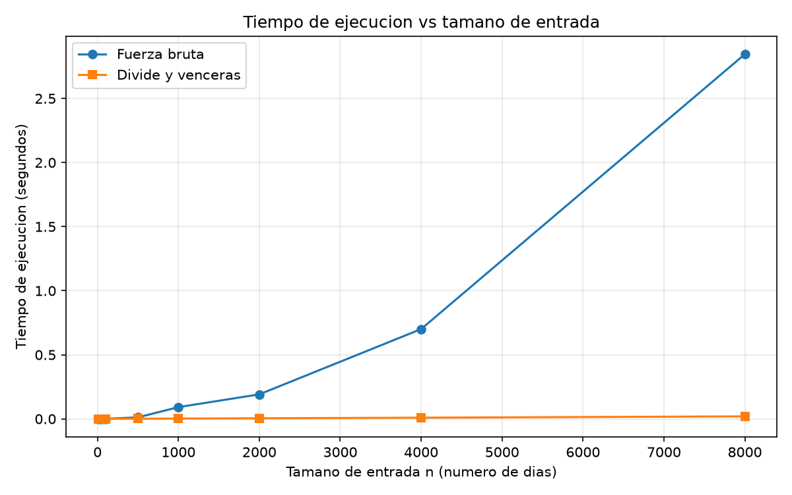

# Laboratorio 2 — Dividir y vencer

**Autor:** Sebastián Berrio Chavarria

## Cómo reproducir

1. Activar el entorno virtual de la raíz del repositorio:
   `.\Activate.ps1`
2. Ejecutar las pruebas (desde `lab2-divide-y-vencer/`): `python pruebas.py`
3. Ejecutar la medición y generar la gráfica: `python medicion.py`

## Parte 1 — Implementar y verificar

Código: [`subarreglo.py`](subarreglo.py) · [`pruebas.py`](pruebas.py)

[Cómo verificaste y qué casos cubriste: serie de ocho días, un elemento,
todos negativos, todos positivos, caso cruzado, 25 listas aleatorias con
semilla fija, y que la lista original no se modifica.]

## Parte 2 — Medir y graficar

Código: [`medicion.py`](medicion.py)

[Nota de medición: semilla 42, enteros entre -100 y 100, misma lista para
ambos algoritmos, 8 tamaños de 10 a 8000, cada medición repetida 3 veces
quedándote con el menor tiempo, cronómetro solo sobre el algoritmo.]

## Parte 3 — Análisis

### 1. Recurrencia
**T(n) = 2T(n/2) +n**
**T(n):**Tiempo de ejecucian
**el numero 2:** indica la cantidad de subproblemas maximo de la mitad izquierdad y mitad derecha.
**El (n/2):** indica que cada uno de los subproblemas es la mitad del arreglo original
**El 0(n):** Es el costo de la funcion. Lo que se demora en calcular desde la mitad a la izquierda y desde la mitad hacia la derecha

 n^logb(a) = n^(log2(2))=> n^1 = n 
caso 2: si f(n) es del mismo orden que nlogb​(a) —es decir, f(n)=Θ(nlogb​a)—, entonces T(n)=Θ(nlogb​alogn). Combinar y recursar pesan lo mismo en cada nivel, y esa igualdad se paga con un factor log n extra.
T(n) = O(n^(logb(a))log(n)) = O(nlog(n))

La fuerza bruta prueba o cada psible resultado por ende nos da algo cuadratico corre mediante dos ciclos anidados lo que nos da ese O(n^2)

### 2. Lo medido contra lo esperado
En la grafica tenemos dos curvas Fuerza bruta O(n^2) y divide y venceras O(nlog(n)). La primera curva tenemos una curva de forma cuadratica, ya que por su naturaleza va creciendo sin freno hasta encontrar el resultado.
Por otro lado esta la curva de divide y venceras que crece con una curva mas achapada, donde crece en los primeros instantes y descpues mantiene un tiempo relativamente constante.

Si tomamos a n entre 4000 y 8000 el tiempo en fuerza bruta se multiplica 4 veces y en divide y venceras se multiplica 2 veces

### 3. Tamaños pequeños
En tamaños pequeños como en n=10 la fuerza bruta es mas rapida, ya no tiene que hacer tanta recursividad, pero una vez crece n su ineficiencia a recorrer toda la lista de 1 en 1 cobra factura, para n = 10 divide y venceras es lento, precisamente por su recursividad, ya que al llamarse asi mismo una y otra vez genera un costo de hardware que que tome mas tiempo pero con datos mas grandes ese tiempo no incrementa mucho por ello es una curva logaritmica.
En conclusión pierde en n = 10 y gana en n = 50

### 4. ¿Cuándo conviene dividir?
Aplicar la tecnica de dividir y venceras conviente cuando el costo de combinar o juntar es menor que resolver usando la fuerza bruta.
Por ejemplo:

si tenemos una lista de numeros recorremos posicion por posicion comparando y actualizando el costo es lineal O(n).

si aplicamos el metodo dividir y venceras, dividimos y comparamos, al ser algo pequeño la ecuacion queda: T(n) = 2T(n/2)+1. Lo que nos lleva al caso 1 nos da O(n).

Se va a tardar lo mismo pero el consumo de recursos es mayor, no conviene

en el subarreglo maximo la fuerza bruta nos da O(n²) pero si lo divimos queda O(n). aquí el cambio si es significante, mejoramos en tiempo y tampoco consume tanto recurso.

### 5. Concepto para la gerente
Basado en pruebas realizadas, mi recomendación es utilizar el algoritmo de divide y vencerás.

Para una serie de 1.000.000 de registros, los tiempos estimados de procesamiento son muy diferentes:

- **Fuerza Bruta:** Tardaría 12.3 horas lo cual paralizaría el sistema
- **divide y vencerás:** Tardaría alrededor de 3.8 segundos, permitiendo una respuesta inmediata y en tiempo real.

El calculo fue de la siguiente manera:

al hacer nuestras pruebas. Calculando la velocidad en la que la maquina trabaja para cada método tenemos que:

- **Fuerza bruta O(n^2):** el método es cuadrático compara cada registro contra todos. Con 8000 registro tardo 2.84 segundos. Al calcular la velocidad de cada comparación tenemos que le cuesta unos 4.446*10^-8 segundos. Si hacemos la estimación (T = 4.446*10^-8 * 1,000,000^2) para 1.000.000 de registros tenemos que son 44.460 segundos o 12.3 horas.

- **Divide y vencerás (n*log(n)):** Este método parte el problema en mitades. Con 8.000 registros tardo unos 0,019 segundos. Al calcular la velocidad de procesamiento. Nos da 1.8*10^-7 al hacer el calculo para 1,000,000 de registros usando la formula correspondiente (1,000,000*log(1,000,000)) el resultado es de 3.71 segundos.

**Advertencia**
Hay que tener en cuenta que esto es una estimación teórica basada en formulas matemáticas. En el escenario real, el tiempo puede subir un poco por detalles físicos de la maquina, como memoria, estrés del procesador, y múltiples factores de hardaware