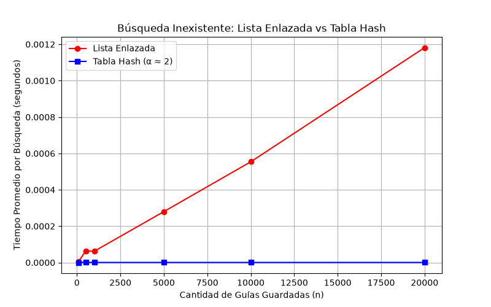
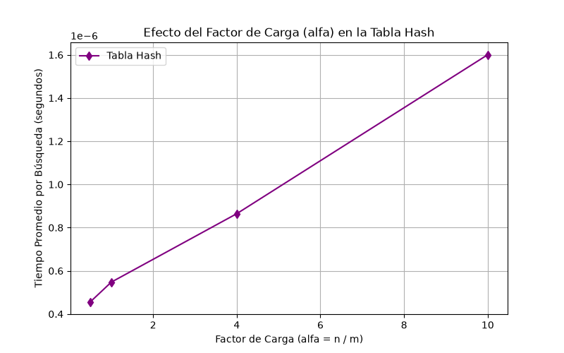

# Informe de Laboratorio 3: Estructiras de Datos

**Autor:** Sebastian Berrio  
**Correo:** sebastianberrio2992232@correo.itm.edu.co  

---

## Instrucciones para Reproducir el laboratorio

1. **Activar el entorno virtual:**  
   Vaya a la raíz del repositorio y active el entorno virtual ejecutando:
   ```bash
   # En Windows (PowerShell)
   .\venv\Scripts\Activate.ps1
   ```
2. **Instalar dependencias:**  
   Asegúrese de tener `matplotlib` listo con el archivo de requisitos:
   ```bash
   pip install -r requirements.txt
   ```
3. **Ejecutar las pruebas de verificación:**  
   Corra el script de validación para ver la tabla de consistencia y los aciertos en la terminal:
   ```bash
   python pruebas.py
   ```
4. **Ejecutar las mediciones de rendimiento:**  
   Genere las gráficas de tiempo ejecutando:
   ```bash
   python medicion.py
   ```

---

## Parte 1 — Verificación de las Estructuras

* Enlaces al código fuente: [estructuras.py](estructuras.py) | [pruebas.py](pruebas.py)

* **Búsquedas básicas:** Se probó qué pasa cuando una guía sí está registrada y qué pasa cuando metemos un número que no existe en el sistema, confirmando que tanto la lista como la tabla hash responden correctamente.
* **Colisión controlada:** Forcé a la tabla a agrupar las guías `10`, `24` y `17` usando un tamaño de tabla $m = 7$. El script validó que las tres guías se guardaron juntas en la casilla número 3, que la lista interna de ese cajón midió exactamente 3 elementos de largo y que el factor de carga marcó $3/7$.
* **Prueba masiva aleatoria:** Corrí 20 simulaciones con colecciones de guías al azar (cambiando la cantidad de datos y el tamaño de la tabla en cada intento). En cada vuelta, se cruzaron los resultados de la lista enlazada y de la tabla hash para comprobar que dieran exactamente la misma respuesta tanto en guías reales como en datos erróneos.

---

## Parte 2 — Gráficas y Metodología de Medición

* Enlace al código de medición: [medicion.py](medicion.py)

### Metodología
 El cronómetro se activó únicamente usando `time.perf_counter()` para medir el viaje dentro de la estructura de datos, dejando por fuera el tiempo que tarda Python en inventarse las guías o en armar los nodos. 

* **Experimento A:** Se midió el rendimiento con tamaños de datos de $n = [100, 500, 1000, 5000, 20000, 50000]$. Para cada tamaño, la tabla hash tomó un tamaño $m$ equivalente al número primo más cercano a $n/2$, manteniendo el factor de carga rozando el valor de 2. En cada punto de datos se realizaron 200 búsquedas de guías inexistentes para promediar el tiempo.
* **Experimento B:** Con un número fijo de $n = 20000$ guías, cambié el tamaño de las casillas de la tabla para obligar al factor de carga ($\alpha$) a tomar los valores de $0.5, 1.0, 4.0$ y $10.0$, promediando de nuevo 200 consultas fallidas por cada nivel.

### Gráficas Obtenidas





---

## Parte 3 — Análisis de Resultados

### 1. Costo Teórico
Buscar una guía que no existe en una lista enlazada nos obliga a recorrerla desde el primer nodo hasta el último antes de poder confirmar que el paquete no está. Como hay que mirar los $n$ elementos uno por uno, el costo siempre es lineal, es decir, $\Theta(n)$. 

En cambio, en la tabla hash vamos directo al cajón que nos da la operación del residuo ($k \pmod m$). El costo de hacer esa matemática es constante $\Theta(1)$, pero al llegar a la casilla nos toca revisar la sublista de colisiones que hay colgada. Si la función hash distribuye los datos de manera uniforme por toda la tabla (supuesto de hash uniforme simple), las guías se reparten por igual y el largo promedio de cada sublista es el factor de carga $\alpha = n/m$. Por eso, el costo promedio es la suma de entrar al cajón más el recorrido interno: $\Theta(1 + \alpha)$. 

Si la función hash llegara a dañarse y mandara las 400.000 guías a la misma casilla, la tabla perdería su magia. Se convertiría en una lista enlazada común y corriente camuflada, y el tiempo de búsqueda se treparía a un espantoso $\Theta(n)$.

### 2. Lo Medido contra lo Esperado
Mirando los datos de la primera gráfica (`lista_vs_tabla.png`) entre los puntos de $n = 20000$ y $n = 50000$, el tiempo de la lista enlazada se multiplicó por un factor muy cercano a $2.5$ (pasó de unos $0.003$ segundos a cerca de $0.0075$ segundos). Como el tamaño de los datos creció $2.5$ veces ($50000 / 20000$), el tiempo aumentó en la misma proporción, lo que encaja perfectamente con el comportamiento lineal $\Theta(n)$. En esa misma gráfica, la curva de la tabla hash se ve completamente acostada en el piso; el tiempo para $n = 20000$ y $n = 50000$ apenas varía por milésimas debido al ruido de la CPU, validando que se comporta de forma constante $\Theta(1)$ porque mantuvimos a $\alpha$ quieto.

En la segunda gráfica (`tiempo_vs_alfa.png`), se nota que al dejar los datos quietos y aumentar el factor de carga $\alpha$ de $0.5$ a $10.0$, el tiempo empieza a dibujar una línea recta hacia arriba. Esto es totalmente coherente con la teoría de $\Theta(1 + \alpha)$, demostrando que si dejas que las sublistas internas se llenen de colisiones, la tabla se vuelve lenta de forma lineal respecto al tamaño de esas colisiones.

### 3. Explicación de las Colisiones
Una colisión pasa cuando dos guías totalmente diferentes, al aplicarles la fórmula matemática de la división, terminan dando el mismo residuo y reclaman el mismo cajón de la tabla. Esto pasa obligatoriamente por el "principio del palomar": aunque tengamos más casillas que guías, los números de las guías en Rutas del Caribe tienen 10 dígitos (miles de millones de combinaciones posibles), y al reducirlos a un tamaño pequeño como $m$, es matemáticamente imposible que no se crucen en algún momento. 

Por ejemplo, con las guías `10`, `24` y `17` y una tabla de $m = 7$:
* $10 \pmod 7 = 3$
* $24 \pmod 7 = 3$
* $17 \pmod 7 = 3$

Las tres guías reclaman la casilla 3. El **encadenamiento** resuelve esto creando una lista enlazada dentro de ese cajón; la ventaja es que la tabla nunca se "llena" y es fácil de programar, pero el costo es que gastamos memoria extra creando nodos y punteros. El **direccionamiento abierto** guarda todo en el mismo arreglo base; si la casilla 3 está ocupada, busca otra casilla vacía más allá (por ejemplo, la 4 o la 5). Su ventaja es que ahorra memoria al no usar punteros, pero su costo es que si la tabla se empieza a llenar, buscar un espacio libre se vuelve un calvario y la estructura puede colapsar si llega al 100% de su capacidad.

### 4. Tabla Hash o Árbol de Búsqueda
Para la necesidad del supervisor de sacar reportes por rango ("guías entre X y Y"), **la tabla hash no sirve para nada**. Las tablas hash funcionan desordenando los datos a propósito mediante la función matemática para repartirlos en los cajones; no hay ninguna relación de cercanía entre el cajón de la guía X y el de la guía Y. Para responder esa consulta, la tabla hash tendría que revisar todos y cada uno de sus cajones, costando un ineficiente $\Theta(m + n)$.

Un árbol de búsqueda binario (ABB) es la solución ideal para los rangos porque mantiene los datos ordenados de izquierda a derecha. Podemos buscar la guía X y, haciendo un recorrido en orden, llevarnos los elementos vecinos de forma secuencial muy rápido. 

Sin embargo, hay un peligro gigante: si las 400.000 guías llegan ya ordenadas de menor a mayor y las metemos una a una, el árbol se "degenerará" convirtiéndose en una línea recta hacia la derecha (básicamente, otra lista enlazada). La altura del árbol sería de 400.000 niveles y buscar un elemento inexistente requeriría hacer aproximadamente las mismas 400.000 comparaciones. Si usáramos un árbol equilibrado (como un AVL o Red-Black), el árbol se autoajustaría para mantenerse chato, logrando una altura óptima de solo $\log_2(400000) \approx 19$ niveles, resolviendo cualquier consulta en apenas 19 operaciones.

### 5. Concepto para la Jefa de Operaciones
**Recomendación Técnica:** Para solucionar los dos problemas de raíz, sugiero implementar una **combinación de estructuras**. Para el call center (consultas puntuales), usaremos la **Tabla Hash con encadenamiento**, manteniendo un factor de carga bajo ($\alpha \le 1$) mediante un redimensionamiento automático si la empresa crece más. Para los supervisores (monitoreo por rangos), usaremos en paralelo un **Árbol de Búsqueda Binario Equilibrado** (como un árbol AVL). Cada vez que llegue un paquete, se registra en ambas estructuras.

**Estimación para 5.000.000 de envíos:**
* **En la Lista Enlazada:** Basándonos en que la curva es estrictamente lineal ($\Theta(n)$), si con $50.000$ guías tardaba unos $0.0075$ segundos, al meter 100 veces más datos ($5.000.000$), el tiempo se multiplicará limpiamente por 100. Esto significa que una consulta fallida tardará aproximadamente **$0.75$ segundos**. En hora pico, con cientos de llamadas, la plataforma se congelará por completo.
